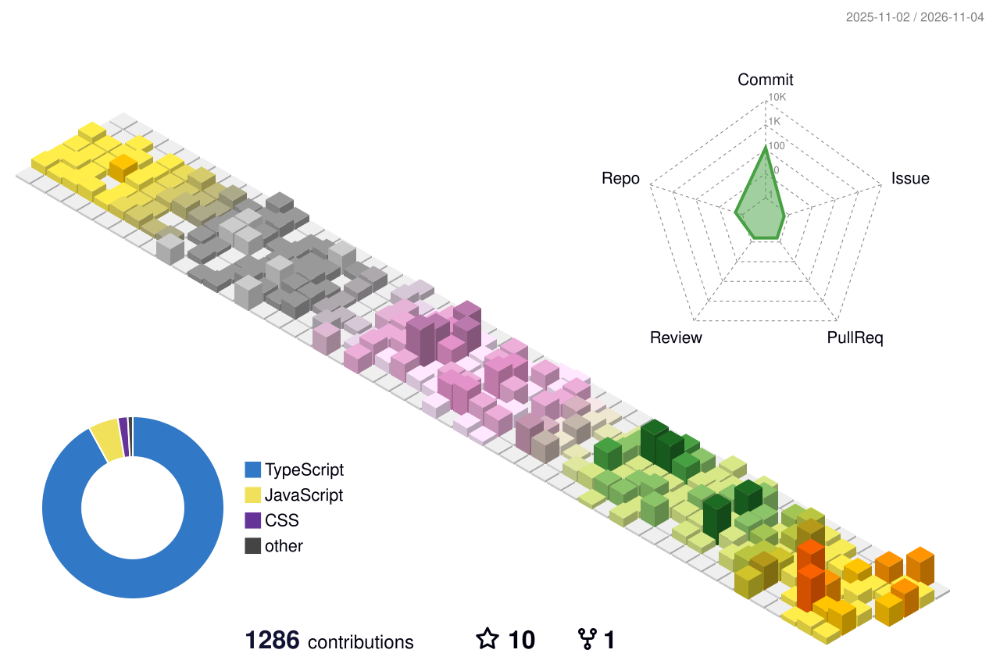

<div align="center">

<a href="https://git.io/typing-svg">
  
</a>

<br/>

<a href="https://modern-portfolio-peach-ten.vercel.app/"></a>
<a href="https://www.linkedin.com/in/aniketkumar07/"></a>
<a href="mailto:aniketkumar639597@gmail.com"></a>
<a href="https://www.youtube.com/channel/UCcvpwbwfY5pkTSV7cjtehJw"></a>


</div>

---

## 👋 About me

```ts
const aniket = {
  role: "Software Engineer @ Catalyze-X",
  location: "Uttar Pradesh, India 🇮🇳",
  education: "B.Tech CSE — MIET Meerut (2021–2025)",
  focus: ["scalable backends", "clean UI/UX", "developer tooling"],
  learning: ["system design", "AI-powered workflows"],
  offline: "gaming 🎮",
};
```

- 🏗️ Ship features end to end: API design → backend → polished React UI
- 🤝 Open to collaborating on interesting side projects and open source

## 🛠️ Tech stack

<table>
  <tr>
    <td align="center"><b>Languages</b></td>
    <td></td>
  </tr>
  <tr>
    <td align="center"><b>Frontend</b></td>
    <td></td>
  </tr>
  <tr>
    <td align="center"><b>Backend</b></td>
    <td></td>
  </tr>
  <tr>
    <td align="center"><b>DevOps & Tools</b></td>
    <td></td>
  </tr>
</table>

## 🚀 Featured projects

| Project | What it does | Stack | Live |
|---|---|---|---|
| [**CanvasFF Studio**](https://github.com/aniketkumar7/canvasff) | Drop clips + a song → beat-synced 1080×1920 "Guess the car" YouTube Short | React · Remotion · Python · GitHub Actions | [▶ Demo](https://canvasff-web.vercel.app) |
| [**LinkVault**](https://github.com/aniketkumar7/LinkVault) | Save and organize links from Reels, Shorts, TikToks and the web | React · Express · Supabase | [▶ Demo](https://link-vault-two.vercel.app/) |
| [**Tydo**](https://github.com/aniketkumar7/Tydo) | Productivity workspace — plan, execute, review in one app | React · Zustand · Supabase | [▶ Demo](https://tydo-rho.vercel.app) |
| [**Kaarigar Studio**](https://github.com/aniketkumar7/kaarigar-studio) | Business site for laser cutting, CNC routing and engraving | React Router v7 · Vite · Tailwind | [▶ Demo](https://kaarigar-studio-mu.vercel.app) |
| [**Netflix GPT**](https://github.com/aniketkumar7/NETFLIX_GPT) | Netflix clone with GPT-powered movie search | React · Redux Toolkit · Firebase · OpenAI | [▶ Demo](https://netflix-gpt-jade-five.vercel.app) |

## 📊 GitHub stats

<div align="center">

<picture>
  <source media="(prefers-color-scheme: dark)" srcset="https://github-profile-summary-cards.vercel.app/api/cards/profile-details?username=aniketkumar7&theme=tokyonight" />
  
</picture>

<picture>
  <source media="(prefers-color-scheme: dark)" srcset="https://github-profile-summary-cards.vercel.app/api/cards/stats?username=aniketkumar7&theme=tokyonight" />
  
</picture>
<picture>
  <source media="(prefers-color-scheme: dark)" srcset="https://github-profile-summary-cards.vercel.app/api/cards/productive-time?username=aniketkumar7&theme=tokyonight&utcOffset=5.5" />
  
</picture>

<picture>
  <source media="(prefers-color-scheme: dark)" srcset="https://github-profile-summary-cards.vercel.app/api/cards/repos-per-language?username=aniketkumar7&theme=tokyonight" />
  
</picture>
<picture>
  <source media="(prefers-color-scheme: dark)" srcset="https://github-profile-summary-cards.vercel.app/api/cards/most-commit-language?username=aniketkumar7&theme=tokyonight" />
  
</picture>

<picture>
  <source media="(prefers-color-scheme: dark)" srcset="https://streak-stats.demolab.com?user=aniketkumar7&theme=tokyonight&hide_border=true&background=1a1b27" />
  
</picture>

<br/><br/>

<picture>
  <source media="(prefers-color-scheme: dark)" srcset="https://raw.githubusercontent.com/aniketkumar7/aniketkumar7/main/profile-3d-contrib/profile-night-rainbow.svg" />
  
</picture>

</div>

## 🏆 Trophies

<div align="center">
  <picture>
    <source media="(prefers-color-scheme: dark)" srcset="https://github-trophies.vercel.app/?username=aniketkumar7&title=MultiLanguage,LongTimeUser,Commits,Repositories,Stars,PullRequest,Followers&column=7&margin-w=10&no-frame=true&no-bg=true&theme=tokyonight" />
    
  </picture>
</div>

## 🐍 Contribution snake

<picture>
  <source media="(prefers-color-scheme: dark)" srcset="https://raw.githubusercontent.com/aniketkumar7/aniketkumar7/output/github-contribution-grid-snake-dark.svg" />
  
</picture>


