<!-- Cards are animated SVGs drawn by scripts/render.py and refreshed daily by .github/workflows/render-cards.yml.
     Edit text/stack/featured repos at the top of scripts/render.py, not here.
     Keep each row of cards on one line with no spaces between <a> tags, or GitHub adds gaps. -->

<a href="https://modern-portfolio-peach-ten.vercel.app/"></a> 
 
 
 
<a href="https://github.com/aniketkumar7?tab=repositories">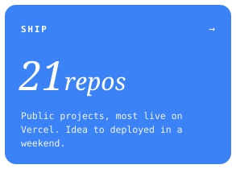</a><a href="https://github.com/aniketkumar7?tab=overview">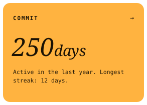</a><a href="https://github.com/aniketkumar7?tab=repositories">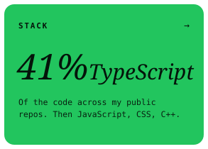</a> 
 
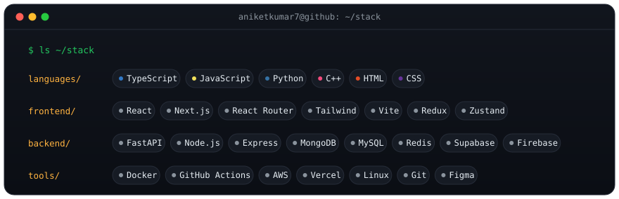 
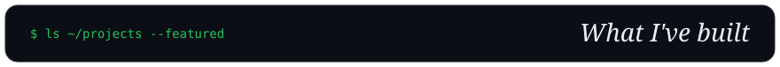 
<a href="https://github.com/aniketkumar7/LinkVault">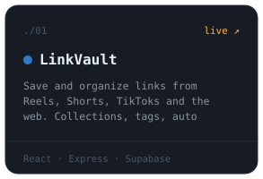</a><a href="https://github.com/aniketkumar7/Tydo">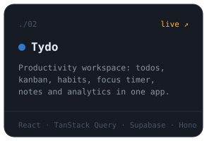</a><a href="https://kaarigar-studio-mu.vercel.app">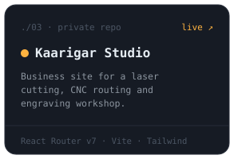</a> 
<a href="https://github.com/aniketkumar7/NETFLIX_GPT">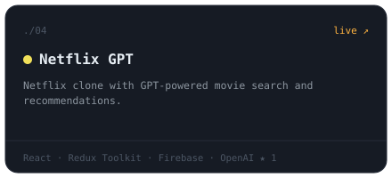</a><a href="https://github.com/aniketkumar7/Modern_Portfolio">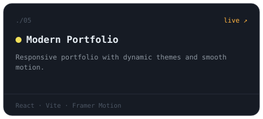</a> 
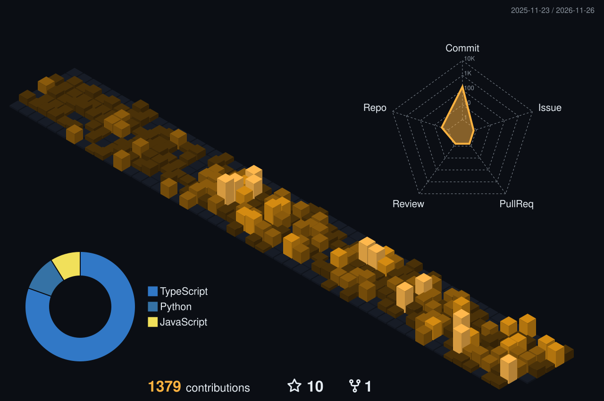 
 
<a href="https://modern-portfolio-peach-ten.vercel.app/">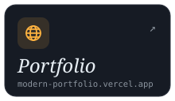</a><a href="mailto:aniketkumar639597@gmail.com">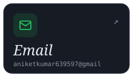</a><a href="https://www.youtube.com/channel/UCcvpwbwfY5pkTSV7cjtehJw">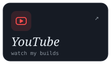</a>

